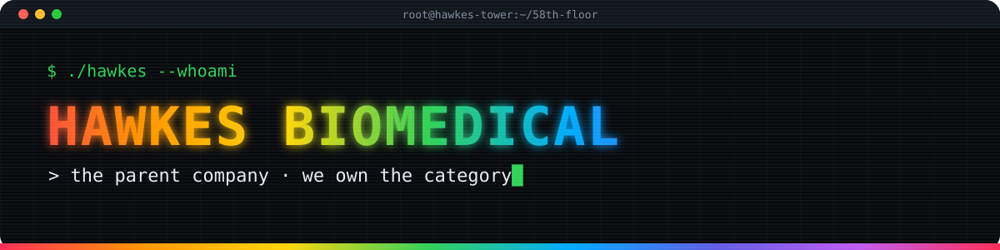

<div align="center">



<a href="https://hawkesbiomedical.com"></a> <a href="https://github.com/jgriffith3433/hawkesbiomedical"></a> <a href="https://github.com/jgriffith3433/hawkesbiomedical"></a> <a href="https://hawkesbiomedical.com"></a>

### 🌈 **THE PARENT COMPANY · WE OWN THE CATEGORY** 🌈

</div>


## ⚡ `$ cat WHOAMI`

> **The corporate front of the whole line. Every product is presented as one of the company's medical products. A work of fiction.**

```diff
+ repo     hawkesbiomedical
+ live     https://hawkesbiomedical.com
+ stack    static HTML · Vite for preview
+ part of  the Hawkes universe: 9 products, 3 engines, one H
```


## 🧬 **THE H** · the whole machine on one screen

```
   ░░ WHO ASKS STUDIO ░░                         ░░ WHO ASKS GEN ░░
   the owner · testers · the clock               editors · game tools · the portal
              │                                               │
   ┏━━━━━━━━━━▼━━━━━━━━━━┓      jobs ━━━━━▶      ┏━━━━━━━━━━━━▼━━━━━━━━━━━━┓
   ┃   HAWKES  STUDIO    ┃                       ┃       HAWKES  GEN       ┃
   ┃   decides           ┃      ◀━━━━━ evidence  ┃       makes             ┃
   ┃   tasks · judges    ┃                       ┃   queue · router · lib  ┃
   ┗━━━━━━━━━━┳━━━━━━━━━━┛                       ┗━━━━━━━━━━━━┳━━━━━━━━━━━━┛
              ▼                                               ▼
   ░ six AI harnesses ░                          ░ rented GPUs · CPUs · browsers ░
   commits ▶ dev ▶ beta ▶ main ▶ 🌐 live          files kept forever, by their content
```

**One side decides, one side makes, and they meet in exactly one place.** Files never cross the bar, only their ids. Nothing ships until evidence about that exact commit has come back.


## 💊 **THE PRODUCT LINE** · presented as medicine, played as games

| Product | Sold as | Live | Repo |
|:--|:--|:--|:--|
| **➤ Hawkes Biomedical** | *the parent company* | [hawkesbiomedical.com](https://hawkesbiomedical.com) | [`hawkesbiomedical`](https://github.com/jgriffith3433/hawkesbiomedical) |
| PH Origins | *pH balance* | [phorigins.com](https://phorigins.com) | [`phoriginswebsite`](https://github.com/jgriffith3433/phoriginswebsite) |
| Sick Of It | *single-use fever shots* | [sickofitgame.com](https://sickofitgame.com) | [`sickofitgamewebsite`](https://github.com/jgriffith3433/sickofitgamewebsite) |
| Dose Of Destruction | *cytotoxic dose* | [doseofdestruction.com](https://doseofdestruction.com) | [`doseofdestructionwebsite`](https://github.com/jgriffith3433/doseofdestructionwebsite) |
| Yooba Land | *hyporexia support* | [yoobalandgame.com](https://yoobalandgame.com) | [`YoobaLandGame`](https://github.com/jgriffith3433/YoobaLandGame) |
| I Can Be | *AI-assisted full-body assessment* | [icanbe.ai](https://icanbe.ai) | [`icanbeaiwebsite`](https://github.com/jgriffith3433/icanbeaiwebsite) |
| The Place Department | *HIPAA-compliant document storage* | [theplacedepartment.com](https://theplacedepartment.com) | [`theplacedepartmentwebsite`](https://github.com/jgriffith3433/theplacedepartmentwebsite) |
| Imagine Live TV | *live medical education* | [imaginelivetv.com](https://imaginelivetv.com) | [`imaginelivetvwebsite`](https://github.com/jgriffith3433/imaginelivetvwebsite) |
| Hawkes Games | *laboratory services* | [hawkesgames.com](https://hawkesgames.com) | [`hawkesgenwebsite`](https://github.com/jgriffith3433/hawkesgenwebsite) |

## 🛠️ **THE ENGINES** · infrastructure, not products

| Engine | Verb | What it is | Live |
|:--|:--|:--|:--|
| Hawkes Studio | **decides** | the manager: Talk, the roadmap, AI agents, playtests, judges, the gate to live | [studio.hawkesgen.ai](https://studio.hawkesgen.ai) |
| Hawkes Gen | **makes** | the maker: one job queue, ~100 generative tools, rented GPUs, a library kept by content hash | [hawkesgen.ai](https://hawkesgen.ai) |
| Hawkes Net | **connects** | multiplayer: tickets, rooms, peer-to-peer with a relay behind it | [net.hawkesgen.ai](https://net.hawkesgen.ai) |


## 🚦 **THE LANES**

```
  dev ──▶ beta ──▶ main
  │       │        └─ 🌐 the live site. Moves only on the owner's word.
  │       └─ 🧪 a private copy, played and judged before anything ships
  └─ 💻 where work happens
```

Every repo has the same six buttons: `dev.bat` · `deploy-beta.bat` · `deploy-prod.bat` · `status.bat` · `links.bat` · `sync.bat`. Addresses and commands for this repo are in [`LANES.md`](LANES.md); the rules for agents are in [`AGENTS.md`](AGENTS.md).


## 📜 **THIS REPO** · the original README, kept

Public site for **Hawkes Biomedical**, the company on the 58th floor of Hawkes Tower. Chairman **Pierce Hawkes**. The board on this site is **Director Hale**, **Voss**, and **Lang**.

This is a corporate brand site. It does not include the game.

## Run

```bash
npm install
npm run dev
```

Open [http://127.0.0.1:5174/](http://127.0.0.1:5174/).

```bash
npm run build      # static site in dist/
npm run preview    # serve the build on port 4174
```

`CNAME` is `hawkesbiomedical.com`.

## Pages

| Path | What |
|---|---|
| `index.html` | Home |
| `company.html` | The company |
| `research.html` | How a product is made (diagram), the line by indication, sourced figures |
| `products.html` | PH Origins, Sick of It, Imagine Live TV, The Place Department, Yooba Land, I Can Be, Dose Of Destruction, Hawkes Gen |
| `leadership.html` | Pierce Hawkes, Hale, Voss, Lang (portraits, roles, founding story) |
| `newsroom.html` | Press-release cards (each opens a `news-*.html` article) and dated statements: Hale, Lang, Voss, the Chairman |
| `investors.html` | Mission, our position, selected figures, Zurich capital desk |
| `compliance.html` | Compliance statement |
| `privacy.html`, `terms.html` | Short legal pages |
| `whatsnew.html` | Release log |
| `styleguide.html` | The design tokens: colour, type scale, spacing, buttons, cards, motion |
| `contact.html` | Tower office and the Zurich desk |

Shared styles and nav live in `site/brand.css` and `site/brand.js`. Photography is in `assets/brand/` (tower and board) and `assets/medical/` (lab, product line, cleanroom); product thumbnails are `assets/products/*-rx.jpg`.

Every page loads Hawkes Analytics (Hawkes Gen's SDK, product `hawkesbiomedical`) and `site/analytics.js`: anonymous site statistics, no cookies, no personal data, as the footer says. See `AGENTS.md` "Analytics".

Do not invent first names for Hale, Voss, or Lang. Do not put the basement, the vat, or the rest of the plot on these pages. The public line is category ownership, not a cure. Products are PH Origins, Sick of It, Imagine Live TV, The Place Department, Yooba Land, I Can Be, Dose Of Destruction, and Hawkes Gen (laboratory services), written as the line, with links out to their sites.


<div align="center">

**🏢 Hawkes Tower · 58th floor · "We do not pitch a cure. We own the category."**

<sub>Hawkes Biomedical and every product in its line are a work of fiction. Built by one person and a great many agents.</sub>

</div>
